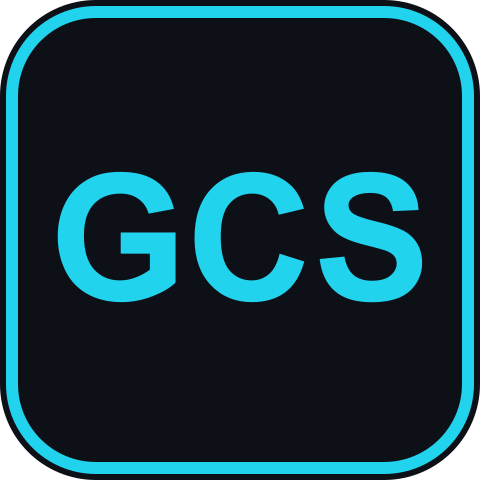
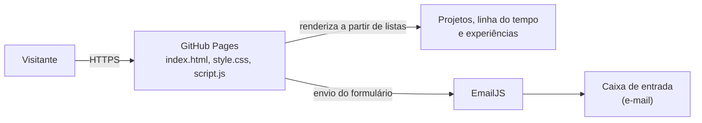
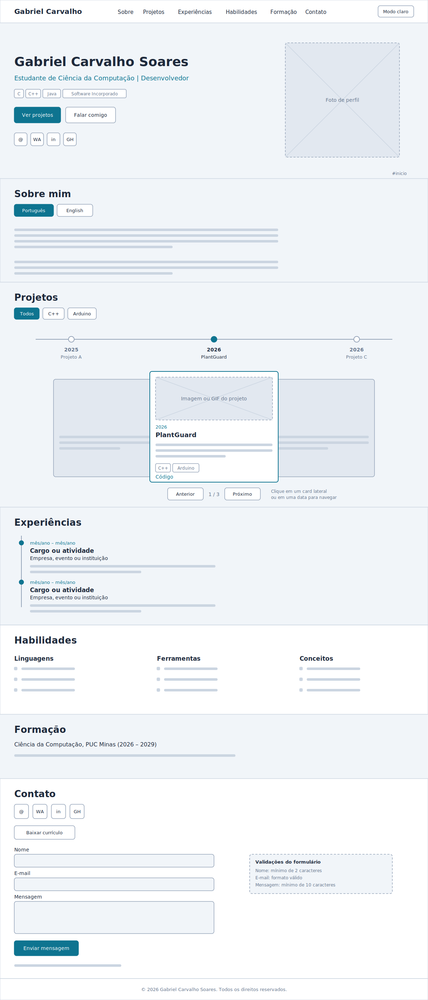
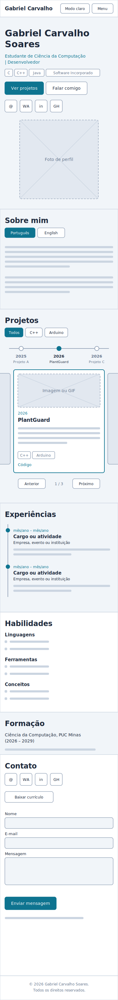

---

# 💼 Portfólio Profissional | Gabriel Carvalho Soares 👨‍💻

> [!NOTE]
> Website de portfólio que reúne minha trajetória, habilidades, projetos acadêmicos e formas de contato, com design responsivo, modo claro/escuro e foco em acessibilidade.

<table>
  <tr>
    <td width="800px">
      <div align="justify">
        Este projeto é o <b>Laboratório 01</b> da disciplina de <b>Desenvolvimento de Interfaces Web (DIW)</b>, do curso de Ciência da Computação da PUC Minas. O site é totalmente <b>bilíngue</b> (português e inglês, com troca pelo cabeçalho) e apresenta uma <i>linha do tempo de projetos</i> (do mais antigo ao mais recente) com imagem ou GIF, as <i>experiências</i>, as <i>habilidades</i>, a <i>formação</i> e uma página de <i>contato</i> com ícones e formulário de envio por e-mail. É feito com <b>HTML, CSS e JavaScript puros</b>, sem framework, e publicado gratuitamente na nuvem.
      </div>
    </td>
    <td>
      <div>
        
      </div>
    </td>
  </tr>
</table>

---

## 🚧 Status do Projeto

      

| Etapa | Entrega | Situação |
| :--- | :--- | :---: |
| **S01** | Repositório, wireframes, protótipo em HTML/CSS/JS, navegação e layout principal | ✅ |
| **S02** | Sobre mim (PT/EN), projetos com linha do tempo, experiências, contato com ícones e formulário, validações e responsividade | ✅ |
| **S03** | Deploy na nuvem, ajustes finais, imagens/GIFs dos projetos e README final | 🚧 |

---

## 📚 Índice
- [Links Úteis](#-links-úteis)
- [Sobre o Projeto](#-sobre-o-projeto)
- [Funcionalidades Principais](#-funcionalidades-principais)
- [Tecnologias Utilizadas](#-tecnologias-utilizadas)
- [Arquitetura](#-arquitetura)
  - [Fluxo do sistema](#fluxo-do-sistema)
  - [Protótipos (wireframes)](#protótipos-wireframes)
- [Instalação e Execução](#-instalação-e-execução)
  - [Pré-requisitos](#pré-requisitos)
  - [Configuração do formulário (EmailJS)](#-configuração-do-formulário-emailjs)
  - [Instalação de Dependências](#-instalação-de-dependências)
  - [Como Executar a Aplicação](#-como-executar-a-aplicação)
  - [Como adicionar projetos e experiências](#-como-adicionar-projetos-e-experiências)
- [Deploy](#-deploy)
- [Estrutura de Pastas](#-estrutura-de-pastas)
- [Demonstração](#-demonstração)
- [Testes](#-testes)
- [Documentações utilizadas](#-documentações-utilizadas)
- [Autores](#-autores)
- [Agradecimentos](#-agradecimentos)
- [Licença](#-licença)

---

## 🔗 Links Úteis
* 🌐 **Site publicado:** [Acesse o portfólio](https://gabrielcarvalhosoa.github.io/NOME-DO-REPOSITORIO/)
  > 💻 **Descrição:** Versão em produção, hospedada gratuitamente no GitHub Pages.
* 🎨 **Protótipo no Figma:** [Veja os wireframes](https://cost-shut-59741518.figma.site/)
  > 🖼️ **Descrição:** Wireframes de média fidelidade das versões desktop e mobile feitas a partir dos Wireframes em SVG.
* 📖 **Documentação:** [Pasta `docs/`](./docs)
  > 📚 **Descrição:** Wireframes (SVG e PNG) feitos com auxílio de I.A. a partir de descrições detalhadas do conteúdo, design e organização do site em conjunto com rascunhos de ilustrações e currículo em PDF.

---

## 📝 Sobre o Projeto

- **Por que existe:** reunir em um só lugar, de forma moderna e acessível, a minha trajetória acadêmica e técnica.
- **Qual problema resolve:** recrutadores e professores conseguem ver, em poucos minutos, quem sou, o que sei fazer e quais projetos já desenvolvi, com links diretos para o código no GitHub.
- **Contexto:** acadêmico (Laboratório 01 de DIW, PUC Minas) e profissional (apresentação para processos seletivos e estágios).
- **Onde pode ser utilizado:** como cartão de visitas digital em currículos, LinkedIn e candidaturas.

---

## ✨ Funcionalidades Principais

- 🧭 **Navegação por seções:** menu fixo no topo, em botão (hambúrguer) em telas menores.
- 🌐 **Site bilíngue (PT/BR e EN):** switch no cabeçalho, sempre visível, que traduz todas as seções e lembra a escolha do visitante.
- 🕒 **Projetos em linha do tempo:** ordem cronológica (do mais antigo ao mais recente), carrossel, filtro por tecnologia, imagem ou GIF, tecnologias e link do repositório.
- 💼 **Experiências:** instituição, cargo ou atividade, período e descrição.
- 🧰 **Habilidades e Formação.**
- 📨 **Contato:** ícones clicáveis (e-mail, WhatsApp, LinkedIn e GitHub), download do currículo e formulário com validações e envio por e-mail.
- 🌓 **Modo claro e escuro:** respeita a preferência do sistema e lembra a escolha do visitante.
- 📱 **Responsivo e acessível:** mobile-first, HTML semântico, navegação por teclado e respeito a `prefers-reduced-motion`.

---

## 🛠 Tecnologias Utilizadas

### 💻 Front-end

* **Estrutura:** HTML5 semântico
* **Estilização:** CSS3 (Flexbox, Grid, variáveis CSS, `clamp()`, `aspect-ratio`), sem framework
* **Linguagem:** JavaScript ES6+ (sem framework ou biblioteca)
* **Fontes:** Google Fonts (Space Grotesk e IBM Plex Sans)
* **Ícones:** SVGs embutidos, adaptados do [Simple Icons](https://simpleicons.org)
* **Gerenciamento de Estado:** variáveis simples em JavaScript e `localStorage` (tema)
* **Build Tool:** nenhuma (o site é estático)

### 🖥️ Back-end

* Não há back-end. O envio de e-mail é feito diretamente do navegador pelo **EmailJS** (`@emailjs/browser` v4.4.1, carregado por CDN).

### ⚙️ Infraestrutura & Design

* **Cloud:** GitHub Pages (hospedagem gratuita)
* **Versionamento:** Git e GitHub
* **Protótipos:** Figma
* **CI/CD:** não utilizado nesta versão

---

## 🏗 Arquitetura

O site é uma **aplicação estática de uma página**, dividida em três camadas simples: `index.html` (estrutura e conteúdo fixo), `style.css` (aparência, tema e responsividade) e `script.js` (comportamento). Os blocos que mudam com frequência (projetos, linha do tempo e experiências) são **gerados por JavaScript a partir de listas de dados** no início do `script.js`, então adicionar um item não exige mexer no HTML.

**Decisões principais:**
- **Sem framework:** o projeto é pequeno e estático, então HTML, CSS e JS puros mantêm o site leve, rápido e fácil de hospedar.
- **Cores e fontes em variáveis CSS:** o tema claro/escuro e a troca de identidade visual acontecem em um único bloco.
- **Carrossel e linha do tempo sincronizados:** a data escolhida na linha do tempo leva o carrossel ao projeto correspondente.
- **Limitação:** as chaves do EmailJS ficam no front-end (são públicas por projeto). O uso indevido é controlado pelas restrições de domínio da conta.

### Fluxo do sistema



### Protótipos (wireframes)

| Desktop | Mobile |
| :---: | :---: |
|  |  |

---

## 🔧 Instalação e Execução

### Pré-requisitos

* **Navegador** atual (Chrome, Edge, Firefox ou Safari)
* **Git** (para clonar o repositório)
* **VS Code** com a extensão **Live Server** (opcional, recomendado) ou **Python 3** (opcional)

---

### 🔑 Configuração do formulário (EmailJS)

O site não usa arquivo `.env`: como é estático, as três chaves do EmailJS ficam no objeto `EMAILJS`, na seção 7 do `script.js`.

| Chave | Descrição | Onde encontrar |
| :--- | :--- | :--- |
| `publicKey` | Chave pública da conta | Account > General |
| `serviceId` | Serviço de e-mail conectado | Email Services |
| `templateId` | Modelo da mensagem | Email Templates |

1. Crie uma conta em [emailjs.com](https://www.emailjs.com) e conecte seu e-mail em **Email Services**.
2. Crie um template que use as variáveis `{{name}}`, `{{email}}` e `{{message}}` (e `{{email}}` em *Reply To*).
3. Copie as três chaves para o objeto `EMAILJS` do `script.js`.

> [!IMPORTANT]
> Ative as restrições de domínio na conta do EmailJS para impedir que terceiros usem suas chaves.

---

### 📦 Instalação de Dependências

Não há nada a instalar (sem Node.js ou `npm`). As bibliotecas externas são carregadas por CDN:

| Recurso | Uso | Versão |
| :--- | :--- | :---: |
| `@emailjs/browser` | Envio do formulário de contato | 4.4.1 |
| Google Fonts | Tipografia | n/a |

Clone o repositório:

```bash
git clone https://github.com/gabrielcarvalhosoa/NOME-DO-REPOSITORIO.git
cd NOME-DO-REPOSITORIO
```

---

### 🚀 Como Executar a Aplicação

**Opção 1: VS Code + Live Server**
Abra a pasta no VS Code, clique com o botão direito em `index.html` e escolha **Open with Live Server**.

**Opção 2: Python**

```bash
python -m http.server 8000
```

Acesse <http://localhost:8000>.

---

### ➕ Como adicionar projetos e experiências

- **Projetos:** no `script.js`, adicione um objeto à lista `projetos` com `titulo`, `data` (`"AAAA-MM"`), `descricao` (texto ou lista de parágrafos), `tags`, `imagem`, `imagemAlt`, `codigo` (link do GitHub) e `demo` (opcional). A ordem e a linha do tempo se ajustam sozinhas.
- **Experiências:** edite a lista `experiencias` (da mais recente para a mais antiga).
- **Tradução:** em `titulo`, `descricao` e `imagemAlt` dos projetos, e nos campos das experiências, use `{ pt: "...", en: "..." }`. Os textos fixos do site ficam no objeto `TEXTOS`, no início do `script.js`.
- **Cores e fontes:** altere as variáveis no início do `style.css`.

---

## 🚀 Deploy

O site é estático e não precisa de build.

**GitHub Pages (usado neste projeto):**

1. Envie o projeto para o GitHub:
   ```bash
   git add .
   git commit -m "feat: publica o portfólio"
   git push origin main
   ```
2. No repositório, abra **Settings > Pages**.
3. Em **Build and deployment**, escolha **Deploy from a branch**, branch `main` e pasta `/ (root)`.
4. Aguarde alguns minutos e acesse o endereço exibido (`https://gabrielcarvalhosoa.github.io/NOME-DO-REPOSITORIO/`).

**Alternativas gratuitas:** Vercel e Netlify também servem o site sem configuração (importe o repositório, sem comando de build).

---

## 📂 Estrutura de Pastas

```
.
├── README.md                    # 📘 Documentação principal do projeto.
├── index.html                   # 🧱 Estrutura da página e conteúdo fixo.
├── style.css                    # 🎨 Estilos, tema claro/escuro (variáveis) e responsividade.
├── script.js                    # ⚙️ Projetos, linha do tempo, experiências, idioma, tema e formulário.
│
├── /img                         # 🖼️ Imagens do site.
│   ├── logo.svg                 # 🏷️ Logo do portfólio.
│   ├── profile.jpg              # 👤 Foto de perfil.
│   └── plantguard.gif           # 🎞️ Imagem ou GIF de cada projeto.
│
└── /docs                        # 📚 Documentação.
    ├── Currículo.pdf            # 📄 Currículo para download.
    ├── /wireframes              # 📐 Protótipos (SVG e PNG).
    └── /screenshots             # 📸 Capturas de tela da seção Demonstração.
```

---

## 🎥 Demonstração

### 🌐 Aplicação Web

| Tela | Captura de Tela |
| :---: | :---: |
| **Página Inicial (Home)** | **Projetos (linha do tempo e carrossel)** |
| _Adicione `docs/screenshots/home.png`_ | _Adicione `docs/screenshots/projetos.png`_ |
| **Sobre mim (PT/EN)** | **Contato (ícones e formulário)** |
| _Adicione `docs/screenshots/sobre.png`_ | _Adicione `docs/screenshots/contato.png`_ |

Projetos em funcionamento (GIFs):

| PlantGuard |
| :---: |
| _Adicione `img/plantguard.gif`_ |

---

## 🧪 Testes

Por ser um site estático, não há testes automatizados nesta versão. Verificações manuais a realizar antes de cada publicação:

- [ ] Layout em 320 px, 768 px e 1440 px de largura
- [ ] Modo claro e escuro
- [ ] Troca de idioma (PT/BR e EN) em todas as seções, no formulário e nos avisos
- [ ] Navegação completa pelo teclado (Tab, Enter, setas no carrossel)
- [ ] Formulário: campos vazios, e-mail inválido e envio com sucesso
- [ ] Links externos (GitHub, LinkedIn, WhatsApp) e download do currículo
- [ ] Lighthouse (desempenho, acessibilidade e SEO) no Chrome DevTools

---

## 🔗 Documentações utilizadas

* 📖 **HTML, CSS e JavaScript:** [MDN Web Docs](https://developer.mozilla.org/pt-BR/)
* 📖 **Envio de e-mail:** [Documentação do **EmailJS**](https://www.emailjs.com/docs/)
* 📖 **Hospedagem:** [Documentação do **GitHub Pages**](https://docs.github.com/pt/pages)
* 📖 **Ícones:** [**Simple Icons**](https://simpleicons.org)
* 📖 **Fontes:** [**Google Fonts**](https://fonts.google.com)
* 📖 **Guia de Estilo:** [**Conventional Commits** (Padrão de Mensagens)](https://www.conventionalcommits.org/en/v1.0.0/)

---

## 👥 Autores

| 👤 Nome | 🖼️ Foto | :octocat: GitHub | 💼 LinkedIn | 📤 Gmail |
|---------|----------|-----------------|-------------|-----------|
| Gabriel Carvalho Soares | <div align="center"></div> | <div align="center"><a href="https://github.com/gabrielcarvalhosoa"></a></div> | <div align="center"><a href="https://www.linkedin.com/in/gabrielcarvalhocomp"></a></div> | <div align="center"><a href="mailto:gabrielcarvalhosoa@gmail.com"></a></div> |

---

## 🙏 Agradecimentos

* [**PUC Minas, Ciência da Computação**](https://www.pucminas.br) - Pelo apoio institucional e pela estrutura acadêmica.
* [**Prof. Dr. João Paulo Aramuni**](https://github.com/joaopauloaramuni) - Pela proposta do laboratório e pelo template de documentação.
* [**Simple Icons**](https://simpleicons.org), [**Google Fonts**](https://fonts.google.com) e [**EmailJS**](https://www.emailjs.com) - Ferramentas gratuitas que tornaram o projeto possível.

---

## 📄 Licença

Este projeto é distribuído sob a **[Licença MIT](https://github.com/joaopauloaramuni/laboratorio-de-desenvolvimento-de-software/blob/main/LICENSE)**.

---
